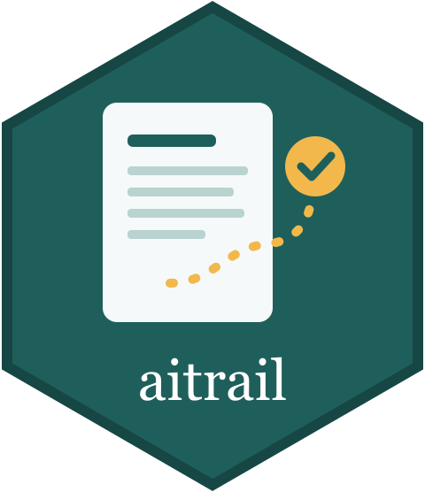

# aitrail 

<!-- badges: start -->
[](https://github.com/pablosancheznunez/aitrail/actions/workflows/ci.yml)
[](https://pablosancheznunez.com/aitrail/)
<!-- badges: end -->

**Document, verify and disclose the use of AI in research.**

Journals, funders and universities increasingly ask researchers to declare how they used AI. That declaration is usually written from memory when the manuscript is finished. aitrail keeps the record while the work happens, phase by phase, and builds the declaration from it:

- **a log per project**, in an `ai-log/` folder versioned with git: which tools and model versions were used, in which phase (literature review, design, data, analysis, interpretation, writing, translation, figures, peer review, communication), for what, and how much of the output was kept;
- **human oversight made explicit**: who verified each use, how, and with what result;
- **an audit** with documented rules that lists gaps, such as uses nobody verified or AI in peer review, without computing a score;
- **reference checks** against Crossref and DataCite, to catch references that do not exist or whose DOI belongs to another paper;
- **disclosure statements** in English and Spanish, short or in full, plus a machine-readable JSON and a self-contained HTML report.

Prompts are stored only as fingerprints by default, because they often contain unpublished or personal data. aitrail does not call any AI model and does not try to detect AI-generated text.

**Website:** <https://pablosancheznunez.com/aitrail/> · **Example report:** <https://pablosancheznunez.com/aitrail/example/report.html>

## Installation

```r
# install.packages("remotes")
remotes::install_github("pablosancheznunez/aitrail")
```

aitrail depends on base R and jsonlite. Install [curl](https://cran.r-project.org/package=curl) to check references.

## Example

```r
library(aitrail)

ait_init(".", title = "Attitudes to open data among early-career researchers")

gpt <- ait_tool("ChatGPT", provider = "OpenAI", model = "GPT-4o", version = "2024-08-06")

use <- ait_register_use("literature_review",
                        task = "Summarise 60 abstracts for first-pass screening",
                        tool = gpt, purpose = "Speed up screening",
                        output_used = "partial", person = "A. Researcher")

ait_verify(use, method = "source_check", outcome = "modified",
           verifier = "A. Researcher", notes = "7 of 60 summaries corrected")

ait_check_references("references.bib", path = ".")   # Crossref and DataCite
ait_audit()                                           # gaps in oversight
ait_disclosure(lang = "en")                           # statement for the manuscript
ait_report(file = "ai-use-report.html")               # report for co-authors or editors
```

The included example project shows every step: `ait_example()`.

## Main functions

| Step | Functions |
|---|---|
| Set up | `ait_init()`, `ait_vocabulary()` |
| Record | `ait_tool()`, `ait_register_use()`, `ait_log_interaction()`, `ait_verify()`, `ait_log()` |
| Check | `ait_check_references()`, `ait_audit()`, `ait_audit_rules()` |
| Disclose | `ait_disclosure()`, `ait_report()` |

The record format is published as a [JSON Schema](https://github.com/pablosancheznunez/aitrail/blob/main/inst/schema/ai-log.schema.json), so other tools can read and write the same logs.

## Citation

If you use aitrail in your research, please cite it: `citation("aitrail")` gives the reference, and the repository's [CITATION.cff](https://github.com/pablosancheznunez/aitrail/blob/main/CITATION.cff) is read by GitHub's "Cite this repository" button.

## Contributing

Bug reports and suggestions are welcome in the [issues](https://github.com/pablosancheznunez/aitrail/issues). See the [contributing guide](https://github.com/pablosancheznunez/aitrail/blob/main/CONTRIBUTING.md).

## License

MIT © Pablo Sánchez-Núñez
